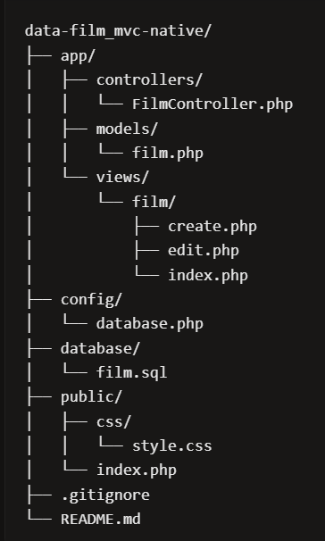

# MVC PHP Native - Aplikasi Pengelola Data Film

Aplikasi CRUD sederhana untuk mempelajari pola Model-View-Controller pada PHP Native.

## Kebutuhan
- PHP 8.0 atau lebih baru
- MySQL/MariaDB
- Web server lokal seperti XAMPP atau Laragon
- Git

## Instalasi
1. Clone atau salin project ke folder web server (Laragon: folder www).
2. Import database/film.sql.
3. Sesuaikan koneksi pada `config/database.php.
4. Buka http://localhost/mvc-native_film/public/index.php.

## Struktur MVC

- `app/models/`        : akses dan operasi data (film.php)
- `app/controllers/`   : alur request dan pemanggilan Model/View (FilmController.php)
- `app/views/film/`    : tampilan HTML (index, create, edit)
- `config/`            : konfigurasi koneksi database
- `database/`          : skema dan data awal SQL (film.sql)
- `public/`            : entry point aplikasi (index.php)
- `public/css/`        : file CSS (style.css)

## Fitur
- Menampilkan data film
- Menambah data film
- Mengubah data film
- Menghapus data film

## Atribut Film
- judul
- genre
- tahun_rilis
- sutradara
- durasi (menit)
- rating

## Histori Git
### git log --oneline --graph --decorate

PS D:\laragon\www\mvc-native_film> git log --oneline --graph --decorate
* 3bb0a8c (HEAD -> main) style: simplify CSS
* d88ad6d docs: add installation and MVC documentation
* 701e0ef feat: add complete CRUD routing
* 5d1b795 feat: add complete film CRUD views
* e6911a1 feat: add complete film CRUD controller
* 731dac4 feat: add complete film CRUD model
* f36448f feat: add PDO database connection
* d73b370 feat: add film database schema and seed data
* 3be74aa chore: initialize mvc php native project
